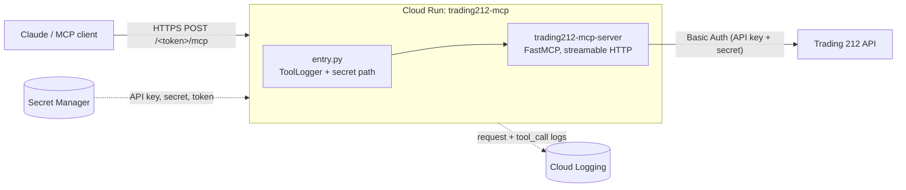

# Trading 212 MCP Server on Google Cloud Run

Host the open-source [trading212-mcp-server](https://github.com/KyuRish/trading212-mcp-server) on Google Cloud Run so you can use your Trading 212 account from Claude (or any MCP client that supports remote servers) on any device, not just a desktop app running a local process.

The upstream package only speaks MCP over **stdio**. This repo adds a small HTTP wrapper, a Dockerfile and a one-command deploy script, plus everything I learned getting it working.

> **Disclaimer:** Not affiliated with Trading 212 or the upstream project. Not financial advice. The server exposes tools that **place and cancel real orders**. Start with `ENVIRONMENT=demo` and read the [Security](#security) section before using live keys.

---

## Contents

- [Architecture](#architecture)
- [What's in this repo](#whats-in-this-repo)
- [Prerequisites](#prerequisites)
- [Quick start](#quick-start)
- [Connect to Claude](#connect-to-claude)
- [Security](#security)
- [Monitoring usage](#monitoring-usage)
- [Performance](#performance)
- [Troubleshooting](#troubleshooting)
- [Known issues in the upstream server](#known-issues-in-the-upstream-server)
- [How I got here (deployment log)](#how-i-got-here-deployment-log)
- [Updating, rotating and tearing down](#updating-rotating-and-tearing-down)
- [Credits](#credits)

---

## Architecture



- **Cloud Run** builds the container from source and runs it on demand (scales to zero when idle).
- **Secret Manager** holds the Trading 212 API key, secret and the URL token, so none of them appear in the service config or shell history.
- **entry.py** wraps the upstream server: serves it over streamable HTTP at a secret path, binds to Cloud Run's `$PORT`, and logs tool names.

## What's in this repo

| File | Purpose |
|---|---|
| `Dockerfile` | Python 3.11 slim image; installs the server with `mcp<2` pinned |
| `entry.py` | HTTP entrypoint: secret path, Cloud Run port binding, Host-check fix, tool-call logging |
| `deploy.sh` | Enables APIs, sets IAM, creates a minimal runtime service account, stores secrets, deploys, prints your connector URL |
| `.gitignore` | Keeps `.env` and similar out of git |
| `LICENSE` | MIT |

## Prerequisites

- A Google Cloud project with **billing linked** (without it, the deploy fails while enabling APIs), and **Owner** role on it
- Trading 212 API key **and** secret: in the Trading 212 app, **Settings → API (Beta)**. Generate them on the **practice (demo)** account first.
- [Cloud Shell](https://shell.cloud.google.com) (easiest, `gcloud` is preinstalled) or a local `gcloud` CLI

## Quick start

**1. Click this button.** It opens Cloud Shell with this repo already downloaded:

[](https://shell.cloud.google.com/cloudshell/editor?cloudshell_git_repo=https://github.com/Shreyamkmr/trading212-mcp-cloudrun&cloudshell_workspace=.&show=terminal)

If Cloud Shell asks whether to trust the repo, choose **Trust**. If it shows an "Authorize Cloud Shell" popup, click **Authorize**.

**2. In the terminal, run:**

```bash
bash deploy.sh
```

It asks a few questions:

- **Which project** to use, if none is selected.
- **`demo` or `live`.**
- **Your Trading 212 API key and secret.** The input is hidden, so nothing shows while you paste. Paste once and press Enter.

Then it does everything else and prints your connector URL.

Without the button, run the same thing by hand in [Cloud Shell](https://shell.cloud.google.com):

```bash
git clone https://github.com/Shreyamkmr/trading212-mcp-cloudrun.git
cd trading212-mcp-cloudrun
bash deploy.sh
```

At the end it prints:

```
Connector URL (treat it like a password, never commit or share it):
    https://trading212-mcp-xxxxxxxxxx.europe-west2.run.app/<token>/mcp
```

Options (prefix the command with them):

| Variable | Default | Meaning |
|---|---|---|
| `ENVIRONMENT` | asks | `demo` = paper trading, `live` = real money |
| `PROJECT_ID` | current project, or asks | Google Cloud project to deploy into |
| `REGION` | `europe-west2` | Cloud Run region. London is close to Trading 212's API. |
| `SERVICE` | `trading212-mcp` | Cloud Run service name |
| `ROTATE_TOKEN` | `0` | `1` = generate a new URL token (old URL stops working) |

Example: `ENVIRONMENT=live bash deploy.sh`

> **`ENVIRONMENT` must match the keys.** Demo keys only work with `demo`, live keys only with `live`. The keys determine which account you see.

### Manual deploy (without the script)

```bash
gcloud services enable run.googleapis.com cloudbuild.googleapis.com artifactregistry.googleapis.com

gcloud run deploy trading212-mcp \
  --source . \
  --region europe-west2 \
  --allow-unauthenticated \
  --cpu-boost \
  --set-env-vars="MCP_TOKEN=<random-token>,TRADING212_API_KEY=<key>,TRADING212_API_SECRET=<secret>,ENVIRONMENT=demo"
```

Generate a token with `python3 -c "import secrets; print(secrets.token_urlsafe(32))"`. This is quicker but leaves your keys in shell history and in the service config, so prefer `deploy.sh`.

## Connect to Claude

1. In Claude, open **Settings → Connectors → Add custom connector**.
2. Paste the URL from the deploy output. It must end in exactly `/mcp`, with no trailing slash.
3. Leave the OAuth fields empty.
4. Test it: *"What's my Trading 212 portfolio value?"*

The server also ships an `analyse_trading212_data` prompt you can attach from the connector menu for a guided portfolio review.

## Security

Read this before using live keys.

- **The URL is the password.** The service is publicly reachable (`--allow-unauthenticated`), because Claude's custom connectors can't send IAM credentials or custom headers. The only protection is the random token in the path. Every other path returns `404`.
- **Anyone with the full URL can trade on your account.** Never commit it, screenshot it, or paste it in issues. If it leaks, run `ROTATE_TOKEN=1 bash deploy.sh` and update the connector.
- **The token appears in Cloud Run request logs.** That's acceptable if you're the only person with access to the Google Cloud project.
- **Keys live in Secret Manager**, not in env vars or shell history (when using `deploy.sh`).
- **The server runs as its own service account** (`t212-mcp-runtime`), which can read its three secrets and nothing else. The default compute account often has `roles/editor` on the whole project, so don't run the server as that.
- **Get alerts on trading activity.** See [Monitoring usage](#monitoring-usage).
- **Stronger option:** put an OAuth layer in front of the server. That's significantly more work and is not covered here.

## Monitoring usage

**Metrics:** Cloud Console → **Cloud Run → trading212-mcp → Metrics** shows request count, latency, errors and instances.

**Request log** (who called, with what status):

```bash
gcloud logging read \
  'resource.type="cloud_run_revision" AND resource.labels.service_name="trading212-mcp" AND logName:"requests"' \
  --limit 50 \
  --format='table(timestamp, httpRequest.requestMethod, httpRequest.status, httpRequest.remoteIp)'
```

A burst of `404`s from unknown IPs means someone is probing for the server.

**Tool usage counts** (from `entry.py`'s structured logs):

```bash
gcloud logging read \
  'resource.labels.service_name="trading212-mcp" AND jsonPayload.event="tool_call"' \
  --limit 1000 --format='value(jsonPayload.tool)' | sort | uniq -c | sort -rn
```

**Alert on trading tools:** in **Logging → Logs Explorer**, run the query below, then click **Create alert**:

```
resource.labels.service_name="trading212-mcp"
jsonPayload.event="tool_call"
jsonPayload.tool=~"place_|cancel_order|delete_pie|create_pie|update_pie"
```

Logs are kept for 30 days by default.

## Performance

Most perceived slowness comes from **Trading 212's API rate limits** (responses can be delayed 5–25 seconds) and **Cloud Run cold starts**. Rewriting the server in another language (Node.js etc.) would not help noticeably.

What this repo already does:

- `--compile-bytecode` in the Dockerfile → faster Python startup
- `--cpu-boost` → extra CPU during container startup
- Default region `europe-west2` → shorter round trips to Trading 212

Optional: `--min-instances=1` removes cold starts entirely, but you pay for an always-on instance. Check Cloud Run pricing first.

## Troubleshooting

| Symptom | Cause | Fix |
|---|---|---|
| `container failed to start and listen on the port defined by PORT=8080` | The upstream server only runs over stdio; there's no `app` for uvicorn to serve | Use `entry.py` from this repo |
| `ModuleNotFoundError: No module named 'mcp.server.fastmcp'` … `This is mcp 2.x` | Upstream doesn't pin `mcp`; v2 renamed `FastMCP` to `MCPServer` | Pin `"mcp<2"` (done in the Dockerfile) |
| `Attribute "app" not found in module` | Same as the first row | Use `entry.py` |
| HTTP `421 Invalid Host header` | The MCP SDK's DNS-rebinding check only allows `localhost` | `entry.py` disables it |
| Connector: *"server asked for sign-in (status 404)"* | Wrong path: root URL, missing token, or trailing slash | Use the exact `…/<token>/mcp` URL |
| Build fails with *permission denied / does not have … access* | New projects don't grant build permissions to the default service account | `deploy.sh` grants `roles/run.builder`, or run the command below. You don't need `roles/storage.admin`. |
| `No module named trading212_mcp_server.__main__` | The package can't be run with `python -m` | Use `entry.py` |
| `Billing account for project … is not found` while enabling services | No billing account linked | Link one under **Billing** in the Console, then redeploy |
| *Setting IAM policy failed* warning, then `403` from the connector | Your organisation blocks public (`allUsers`) access | Replace `--allow-unauthenticated` with `--no-invoker-iam-check` |
| *Cannot update environment variable … different type* | Switching a plain env var to a secret | `gcloud run services update trading212-mcp --region <REGION> --remove-env-vars=TRADING212_API_KEY,TRADING212_API_SECRET,MCP_TOKEN`, then redeploy |
| `Rate limited by Trading 212 after multiple retries` | Trading 212 API limits (CSV exports are especially strict) | Wait a few minutes and retry |

Grant build permissions manually:

```bash
PROJECT_ID=$(gcloud config get-value project)
PROJECT_NUMBER=$(gcloud projects describe $PROJECT_ID --format='value(projectNumber)')
gcloud projects add-iam-policy-binding $PROJECT_ID \
  --member="serviceAccount:${PROJECT_NUMBER}-compute@developer.gserviceaccount.com" \
  --role="roles/run.builder"
```

Read the latest container logs:

```bash
gcloud run services logs read trading212-mcp --region <REGION> --limit 30
```

## Known issues in the upstream server

These come from `trading212-mcp-server` 0.4.0 itself, not from this deployment:

- **Unpinned `mcp` dependency.** It breaks on fresh installs, including `uvx`. Pinned here.
- **London (GBX) per-position values are in pence**, so they appear 100× too high (e.g. a £12,900 holding shows as 1,289,704). Account-level totals are correct.
- **US per-position values are in USD**, not the account currency. The `ppl` (profit/loss) fields are in GBP and reliable.
- **No realised P/L.** `fillResult` is empty in the order history API. For realised gains, export CSV history from the Trading 212 app (**History → Export**) and use the *Result* column.

Consider reporting these upstream: <https://github.com/KyuRish/trading212-mcp-server/issues>

## How I got here (deployment log)

Reconstructed from the project's **Cloud Audit Logs** (every change made to the project), my Cloud Shell history and the container logs. It all happened in one evening, from project creation to a working server in about 47 minutes. Times are UTC. All deploys used `gcloud run deploy --source .` to `us-central1` with `--allow-unauthenticated` and the API keys passed as plain `--set-env-vars`.

| Time | What I did | What happened |
|---|---|---|
| 21:55 | Created the project in the Console | Project created. |
| 22:08 | First `gcloud run deploy` (twice) | **Failed before building.** gcloud tried to enable Cloud Run, Cloud Build and Artifact Registry, but the project had **no billing account** linked. |
| 22:24 | Linked a billing account, deployed again | The APIs were enabled. Google automatically set up its service agents and **gave the default compute service account `roles/editor`** on the whole project. The Cloud Run service and the `cloud-run-source-deploy` image repository were created. |
| 22:25 | (same deploy) | **Build failed:** *"the default service account is missing required IAM permissions"*. It couldn't read the uploaded source from Cloud Storage. |
| 22:26 | Granted `roles/run.builder`, then `roles/storage.admin`, to the default compute service account | IAM changes applied. |
| 22:27 | Redeployed. Container: `uv venv` + `uv run trading212-mcp-server --transport sse --port $PORT` | Built. Revision `00001` crashed: `ModuleNotFoundError: No module named 'mcp.server.fastmcp'`, because pip had pulled in `mcp` 2.x. |
| 22:30 | `python -m trading212_mcp_server --transport sse` | Revision `00002` crashed: `No module named trading212_mcp_server.__main__`. |
| 22:32 | `trading212-mcp-server start --transport sse` | Revision `00003` crashed: the same `mcp` 2.x error. |
| 22:34 | `uvicorn trading212_mcp_server.server:app` | Revision `00004` crashed: the same error. There's also no `app` object to serve. |
| ~22:35 | `gcloud run services logs read trading212-mcp --region us-central1` | The logs showed the real cause behind every crash. |
| 22:42 | Wrote `entry.py` (streamable HTTP, `0.0.0.0:$PORT`, Host check off) and pinned `trading212-mcp-server==0.4.0` and `mcp<2` | **Revision `00005` deployed and served.** |
| later | Added the connector in Claude | The bare service URL gave a 404. It has to end in `/mcp`. After that, portfolio queries worked. |

Each successful deploy also set the Cloud Run IAM policy so that `allUsers` could invoke the service. That's what `--allow-unauthenticated` does.

Lessons:

- **Link billing before the first deploy.** Without it, gcloud can't enable the APIs Cloud Run needs.
- **Read the container logs first.** Revisions `00002`–`00004` were guesses at the startup command, while the actual problem (the `mcp` 2.x import) was the same every time and visible in the logs.
- **The `--transport sse --port` flags never existed.** The CLI takes no arguments. Transport is picked from the `TRANSPORT` environment variable, and it listens on localhost only, which is why a wrapper is needed on Cloud Run.
- **Watch what your server runs as.** Cloud Run used the default compute service account, which by then had `editor`, `run.builder` and `storage.admin` on the whole project. Anything that compromised the container would have had near-full control of the project. `deploy.sh` now runs the server as a dedicated account with no project roles, only access to its own secrets.
- **`roles/storage.admin` wasn't needed.** `roles/run.builder` covers source deploys. The 22:25 build failure was most likely IAM propagation, since the automatic grants had been made seconds earlier.

### Added afterwards for this repo

Not part of the original deployment, but included here because the original setup (public URL, live keys in plain env vars) was too exposed:

- Secret URL path (`/<token>/mcp`), so knowing the service URL isn't enough.
- Keys and token in Secret Manager instead of env vars.
- A dedicated runtime service account (`t212-mcp-runtime`) with no project roles, instead of the default compute account.
- Per-tool usage logging and an alert on trading tools.
- Faster startup: bytecode compilation, `--cpu-boost`, default region `europe-west2`.
- `deploy.sh` to do all of the above in one command.

## Updating, rotating and tearing down

```bash
# Redeploy after changes (press Enter at the key prompts to keep existing secrets)
bash deploy.sh

# New URL token (update the connector afterwards)
ROTATE_TOKEN=1 bash deploy.sh

# New Trading 212 keys: generate them in the app, then
bash deploy.sh          # and paste the new values

# Remove everything
gcloud run services delete trading212-mcp --region <REGION>
gcloud secrets delete t212-api-key
gcloud secrets delete t212-api-secret
gcloud secrets delete t212-mcp-token
gcloud iam service-accounts delete t212-mcp-runtime@<PROJECT_ID>.iam.gserviceaccount.com
```

## Credits

- [trading212-mcp-server](https://github.com/KyuRish/trading212-mcp-server) by Rishabh Dogra (MIT): all the actual Trading 212 tools.
- [Model Context Protocol](https://modelcontextprotocol.io/) Python SDK.
